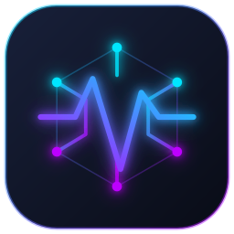
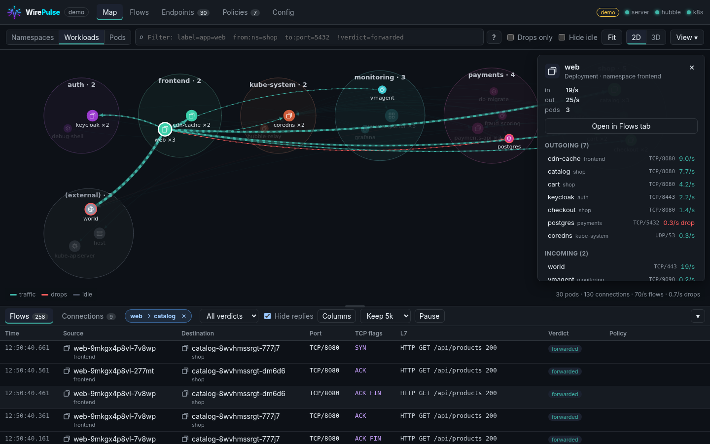
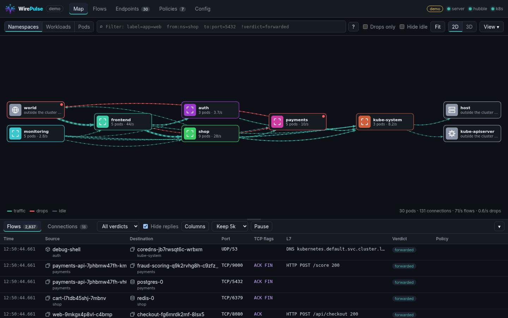
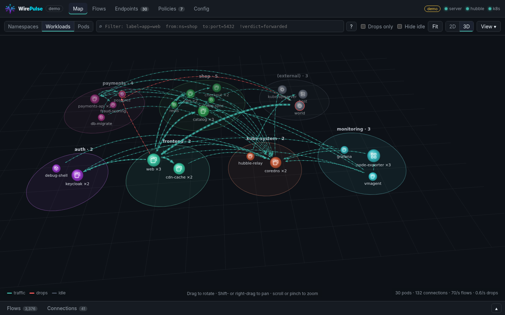
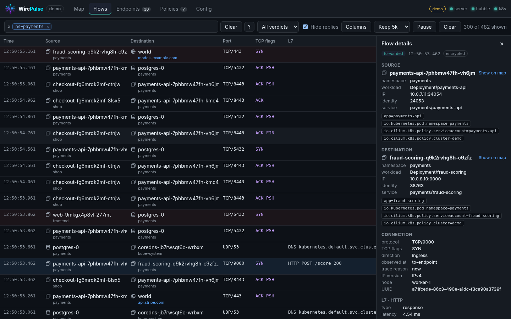
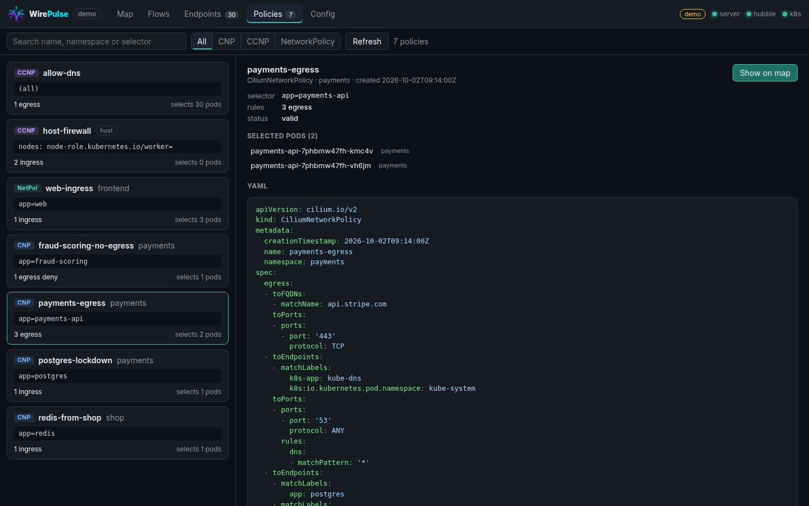

<p align="center">
  
</p>

<h1 align="center">wirepulse</h1>

<p align="center">
  A live map of your Cilium cluster's traffic, and a Hubble UI replacement written in Rust.
</p>

<p align="center">
  <strong>Every namespace and pod on one map.</strong><br>
  <strong>Every flow, filtered the Hubble way.</strong><br>
  <strong>Read-only and in memory: nothing is stored.</strong>
</p>

<p align="center">
  <a href="https://github.com/amreshh/wirepulse/actions/workflows/ci.yaml"></a>
  <a href="https://github.com/amreshh/wirepulse/releases"></a>
  
  
  <a href="LICENSE"></a>
</p>

<p align="center">
  One static binary · a ~18 MB image · read-only RBAC · works on phones
</p>

<p align="center">
  
</p>

## Contents

- [Features](#features)
- [Try it without a cluster](#try-it-without-a-cluster)
- [Run it against your cluster](#run-it-against-your-cluster)
- [Settings](#settings)
- [How much flow history is kept](#how-much-flow-history-is-kept)
- [Access and permissions](#access-and-permissions)
- [How it works](#how-it-works)
- [Development](#development)
- [Not done yet](#not-done-yet)

## Features

### The map

- Every namespace and pod in the cluster on one canvas, at three zoom levels:
  **namespaces**, **workloads** and **pods**.
- Connections show live Hubble flow rates; drops are red. Traffic to and from
  outside the cluster (world, host, kube-apiserver) is grouped separately.
- Every node has an icon for what it is: Deployment, StatefulSet, DaemonSet,
  Job, CronJob, standalone Pod, world, host, API server.
- Click a node for its connections, ports and rates, and the policies that
  select it.
- **View** menu, remembered per browser: presets *Bubbles*, *Boxes*,
  *Cards* (Hubble-style) and *Flow*; circles or cards; packed, or left → right
  in the direction of traffic; curved, straight or right-angle edges.
- **3D**: *Map* (namespaces on the ground, traffic arcing over them) or
  *Tower* (one floor per namespace). Drag to orbit, Shift- or right-drag to
  pan, scroll or pinch to zoom.

### Flows

- A **traffic panel** under the map follows what you select: a node, one of
  its connections, or the pods a policy selects.
- A full-screen **Flows** tab shows the same table.
- **Columns** to choose from: source and destination (with IP, port and
  identity), TCP flags, L7 (HTTP, DNS), latency, verdict and drop reason,
  direction, observation point, policy and node. Drag a column's edge to
  resize it.
- **Flow details**: labels, services, DNS answers, HTTP status, UUID, and the
  policy that allowed or denied the flow (when your Cilium version reports it).
  The details panel can be resized too.
- **Connections**: per-connection flow and drop rates, totals and last seen.
- **History that stays put**: flows that match your filter or selection are
  kept apart from the rest of the cluster's traffic, so they don't scroll away
  (see [below](#how-much-flow-history-is-kept)).

### Filters

One filter bar is shared by the map, the traffic panel, Flows and Endpoints:

| Term | Matches |
|---|---|
| `label=app=web` | a label value; `label=app` checks the key exists |
| `pod=web`, `ns=shop`, `workload=web` | pod name prefix, namespace, Deployment/StatefulSet/… name |
| `ip=10.0.0.0/8`, `dns=*.stripe.com`, `identity=12345` | address or CIDR, DNS name, security identity |
| `port=5432`, `protocol=udp`, `verdict=dropped` | destination port, protocol, verdict |
| `node=worker-1`, `policy=lockdown` | the node that saw the flow, the policy that allowed or denied it |
| `from:…`, `to:…`, `!…` | only the source or destination side; exclude |
| any other word | names, IPs, DNS names, HTTP paths |

Several terms of one kind match any of them, different kinds must all match.
Suggestions come from live data, and clicking a label anywhere adds it. The map
hides what doesn't match (switchable in the View menu).

### Endpoints, policies and config

- **Endpoints**: every Cilium endpoint (`CiliumEndpoint`, or
  `CiliumEndpointSlice` when slices are enabled) with endpoint ID, security
  identity, labels, IPs, node, state, policy enforcement and live traffic.
  Sortable, with the object's YAML.
- **Policies**: every `CiliumNetworkPolicy`, `CiliumClusterwideNetworkPolicy`
  and `NetworkPolicy`, with rule counts, the pods each one selects right now,
  and the YAML. *Show on map* highlights the selected pods.
- **Config**: the `cilium-config` ConfigMap, searchable and grouped by topic,
  with a summary of the key settings and any `CiliumNodeConfig` overrides.

| | |
|---|---|
|  |  |
|  |  |

## Try it without a cluster

```sh
rustup target add wasm32-unknown-unknown
cargo install trunk --locked

(cd frontend && trunk build --release)
cargo run --release -p backend -- --demo
# open http://localhost:8080
```

`--demo` runs a synthetic cluster (6 namespaces, ~24 pods, policies, config,
rolling restarts) through the same code paths as real data. The screenshots
above are of it.

## Run it against your cluster

**From your machine**, with your kubeconfig and a port-forward to hubble-relay:

```sh
kubectl -n kube-system port-forward svc/hubble-relay 4245:80
cargo run --release -p backend -- --hubble-relay http://127.0.0.1:4245
```

**In the cluster**: each release is published as
`ghcr.io/amreshh/wirepulse:<version>`, or build your own:

```sh
docker build -t <registry>/wirepulse:0.1.0 .
docker push <registry>/wirepulse:0.1.0
# set the image in deploy/wirepulse.yaml, then
kubectl apply -f deploy/wirepulse.yaml
kubectl -n wirepulse port-forward svc/wirepulse 8080:80
```

## Settings

| Flag | Env | Default |
|---|---|---|
| `--hubble-relay` | `HUBBLE_RELAY_ADDR` | `http://hubble-relay.kube-system.svc.cluster.local:80` |
| `--cilium-namespace` | `CILIUM_NAMESPACE` | `kube-system` |
| `--cilium-configmap` | `CILIUM_CONFIGMAP` | `cilium-config` |
| `--flow-history` | `WIREPULSE_FLOW_HISTORY` | `5000` flows (100 to 1,000,000) |
| `--listen` | `WIREPULSE_LISTEN` | `127.0.0.1:8080` (container image: `0.0.0.0:8080`) |
| `--allowed-hosts` | `WIREPULSE_ALLOWED_HOSTS` | IP addresses and `localhost` |
| `--static-dir` | `WIREPULSE_STATIC_DIR` | `frontend/dist` |
| `--demo` | `WIREPULSE_DEMO` | off |

Logging uses `RUST_LOG` (default `info,tower_http=warn,kube=warn`).

## How much flow history is kept

Everything is in memory, in two places:

- **The browser** keeps the newest flows of the whole cluster, and apart from
  them the newest flows that match the filter, and those of the node or
  connection selected on the map. Only flows of the same kind push old ones
  out, so a quiet pod's flows stay in the table however busy the rest of the
  cluster is. How many of each is the **Keep** setting beside the table (1k to
  50k, default 5k, remembered per browser). Reconnecting to the same server
  carries on where it left off; a reload starts from what the server has.
- **The server** keeps the newest `--flow-history` flows in full (default
  5,000): what the flow details panel can show, and what a newly opened page
  starts with. Each takes about 3 KB, more when endpoints carry many labels.
  Rows older than that still open, with what the table knows about them.

Hubble keeps its own, per node: `hubble-event-buffer-capacity` (Helm
`hubble.eventBufferCapacity`, default 4095). `hubble observe --last N` reads
that.

## Access and permissions

wirepulse has no login: anyone who can reach it sees your cluster's traffic.
`kubectl port-forward` keeps it on your machine and needs no settings. Behind
an Ingress:

- list the name(s) it is served under, e.g.
  `WIREPULSE_ALLOWED_HOSTS=wirepulse.example.com` (`*.example.com` for
  subdomains). wirepulse refuses requests for other host names, so a web page
  cannot point its own domain at wirepulse (DNS rebinding) and read it;
- put authentication in front of it, e.g. oauth2-proxy or your Ingress
  controller's auth.

The live stream (`/api/ws`) also refuses connections opened by pages from
other sites.

Everything it needs is read-only (see `deploy/wirepulse.yaml`):

- `pods`, `namespaces`: get/list/watch (the map inventory)
- `ciliumendpoints`, `ciliumendpointslices`: get/list/watch (the Endpoints tab)
- `ciliumnetworkpolicies`, `ciliumclusterwidenetworkpolicies`,
  `networkpolicies`, `ciliumnodeconfigs`: get/list
- the single `kube-system/cilium-config` ConfigMap: get

If Kubernetes access fails, the map still works from flows alone.

## How it works

```
hubble-relay ──gRPC GetFlows(follow)──┐
                                      ▼
Kubernetes API ──watch/list──▶  backend (axum, tonic, kube-rs)
                                  │ per-edge flow rates (EWMA)
                                  │ policy → pod selection
                                  ▼
                       WebSocket: graph every 2 s, flows every 0.5 s
                       REST: /api/policies /api/config /api/endpoints
                             /api/flows /api/flows/{id} /api/info
                                  ▼
                    frontend (Leptos → WASM, canvas renderer)
```

```
common/    shared types + pure logic, unit-tested once, used on both sides:
           aggregation (pod → workload → namespace), label-selector matching,
           deterministic layouts, the filter language (filter.rs)
backend/   hubble.rs (relay client), k8s.rs (reflectors), policy.rs,
           endpoints.rs, config.rs, flows.rs (rates), state.rs, api.rs, demo.rs
           proto/ = vendored Cilium v1.19.0 Hubble protos (compiled with
           protox, so no protoc needed)
frontend/  Leptos app; store.rs keeps the flows, scene.rs is the canvas
           renderer and pointer handling, scene/three.rs the 3D camera,
           icons.rs the workload icons, settings.rs the saved preferences
```

Design notes:

- **Stable layout.** Namespaces are circles packed in name order and pods sit
  on a sunflower spiral inside them. The picture doesn't jump around as flows
  arrive, and a new pod only moves its own namespace. Rows adapt to the
  screen's aspect ratio.
- **Rates, not logs.** Each connection keeps a smoothed flows/s and drops/s
  rate. Reply flows are skipped so every connection is drawn once. Idle
  connections fade after 5 minutes; connections to deleted pods after 30 s.
- **Details on demand.** The live stream carries a compact row per flow; the
  full records stay on the server (`/api/flows/{id}`).
- **Each flow is checked once.** The browser tests a flow against the filter
  when it arrives, not on every redraw, so a narrow filter over a big history
  stays cheap.
- **3D without WebGL.** The 3D view projects the same layout through an orbit
  camera onto the 2D canvas, so it shares selection, filters and icons with
  the flat map.
- **Busy clusters.** The backend counts every flow but sends at most 400 per
  half-second to the UI. The canvas drops to ~25 fps above 1,500 connections
  and stops animating above 3,000.

## Development

```sh
cargo test -p common -p backend -p frontend   # unit tests + a fake hubble-relay
cargo run -p backend -- --demo                # API on :8080
(cd frontend && trunk serve)                  # UI on :8081 with hot reload, proxies /api
leptosfmt frontend/src && cargo fmt --all     # formatting, as CI checks it
```

## Not done yet

- **Byte rates per pod**: Hubble flows carry no byte counts. Planned: read
  kubelet stats or VictoriaMetrics/Prometheus
  (`container_network_*_bytes_total`) and show them on the nodes.
- **TLS to hubble-relay**: plaintext only for now (the Helm default).
- **What each agent actually enforces**: policies are shown as defined in
  Kubernetes; per-endpoint enforcement would need the Cilium agent API.
- **Multi-cluster** (ClusterMesh) views.

## License

[MIT](LICENSE)
